# 🛡️ FlowGuard AI

**Don't just review code. Investigate what could go wrong — and know what the evidence actually proves.**

> **FlowGuard AI** is a browser-based behavioral-risk analysis and verification playground. It compares code changes with business rules, surfaces *potential* failures, prepares verification scenarios, and demonstrates concurrency failures using controlled, executable first-party fixtures.

[**🚀 Launch the live app**](https://flowguard-ai-smoky.vercel.app/) · [**🧪 Try the Verification Lab**](https://flowguard-ai-smoky.vercel.app/lab) · [**🔍 Analyze a PR or snippet**](https://flowguard-ai-smoky.vercel.app/analyze) · [**✅ See the official TestSprite run**](https://www.testsprite.com/dashboard-v3/o/28a6d5ec-2a40-54eb-9bf6-0c87db224fde/projects/570eab99-607a-49fa-96b2-fe5ef724f2d9/execution/a1c6ffa8-c597-4c2e-95d9-027504a84dbc)

| Verified milestone | Evidence | Exact tested version |
| :--- | :--- | :--- |
| **TestSprite V3: 97 passed · 0 failed · 0 blocked** | [Official vendor execution](https://www.testsprite.com/dashboard-v3/o/28a6d5ec-2a40-54eb-9bf6-0c87db224fde/projects/570eab99-607a-49fa-96b2-fe5ef724f2d9/execution/a1c6ffa8-c597-4c2e-95d9-027504a84dbc) | PR #14 **earlier** commit `7324ee5`; does not verify later commits |
| **118/118 Vitest · 70/70 Chromium Playwright** | [GitHub CI 40209717826](https://github.com/allfridhosaragii/FlowGuard-AI/actions/runs/40209717826) | PR #14 later code commit `170b8875`, 25 Oct 2026 |
| **2/2 hosted keyboard regressions** | [Exact hosted preview audit](https://github.com/allfridhosaragii/FlowGuard-AI/actions/runs/40209717811) | PR #14 later code commit `170b8875` |
| **Genuine in-window GitHub App PR** | [PR #1, opened Oct 20](https://github.com/allfridhosaragii/FlowGuard-AI/pull/1) | Its original 22 passed / 1 blocked is **not** 97/97 |

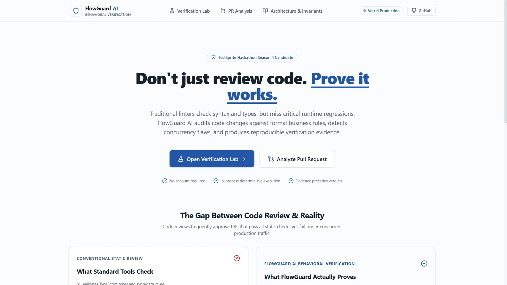

<details><summary><strong>View the mobile experience</strong></summary>

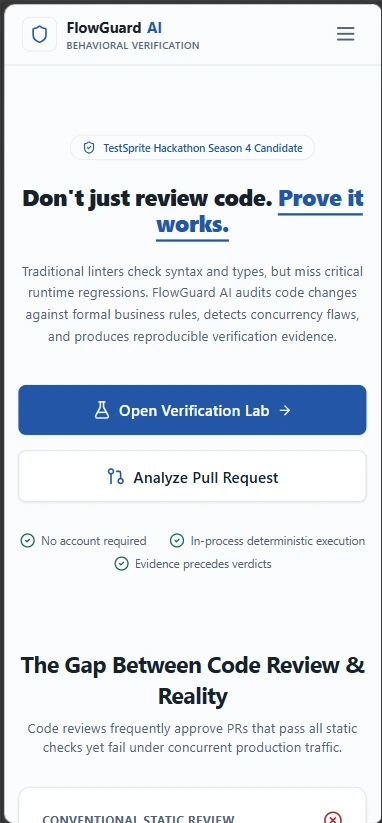

</details>

## Why we care: behind a software failure is a real person

Software reliability isn't an abstract engineering scoreboard. Sometimes a payment appears cancelled while a balance has decreased. Sometimes a customer cannot access money they expected to have available. These are **public reports of user experiences**, not independently established diagnoses of backend code defects.

| Publicly reported experience | What it illustrates | Primary source |
| :--- | :--- | :--- |
| An Indonesian user said a QRIS-funded in-app purchase was marked **cancelled** although their mobile-banking balance had been debited. | A payment's customer-facing state can differ across systems; resolving the discrepancy matters to real people. | [r/indotech, November 2025](https://www.reddit.com/r/indotech/comments/1osvnyi/jebakan_betmen_apa_ada_yang_pernah_gagal/) |
| An Uber Eats customer described apparently duplicated transactions and temporarily unavailable funds; participants discussed whether one entry was an **authorization hold** rather than a second settled charge. | Even an unresolved or held transaction can undermine trust and liquidity. | [r/UberEATS, April 2026](https://www.reddit.com/r/UberEATS/comments/1sn6soa/uber_this_is_ridiculous/) |
| A Medusa contributor reported a refund-retry path that could use different idempotency keys after provider errors. | Retry behavior and business state transitions deserve explicit review. The risk of double refund is **conditional**, not proof that customers were refunded twice. | [medusajs/medusa issue #16681](https://github.com/medusajs/medusa/issues/16681) |

**What these links do *not* prove:** that the reported consumer incidents share one root cause; that any commenter requested or endorses FlowGuard AI; or that this app prevented their losses. They are **problem-context evidence**, not product-market-fit research or testimonials.

For the engineering rationale, see [Stripe's idempotent-request API documentation](https://docs.stripe.com/api/idempotent_requests) and [Google's SRE workbook on canary releases](https://sre.google/workbook/canarying-releases/). They explain why retried operations need careful identity/semantics and why repeatable automated checks matter during software changes.

## The practical gap: valid code can still break a business rule

A type checker can approve two syntactically valid requests, while a non-atomic payment handler still allows a duplicate side effect. Existing linters, code review, integration tests, and dedicated test platforms all matter; **FlowGuard AI complements them** by asking a different question:

> *Does this proposed code change threaten a business invariant — and what evidence would be required to confirm or reject the concern?*

For example:

```text
Business invariant INV-REFUND-001:
For any given logical idempotency key,
committed_refund_side_effect_count(key) <= 1
```

FlowGuard can identify a **POTENTIAL** race from a snippet or public PR and suggest an assertion. It **cannot** mark arbitrary GitHub PR code as `VERIFIED_FAIL` merely by reading it. Only running a specific controlled test against a specific executable target can produce an evidence-backed verdict.

## How the two workflows fit together

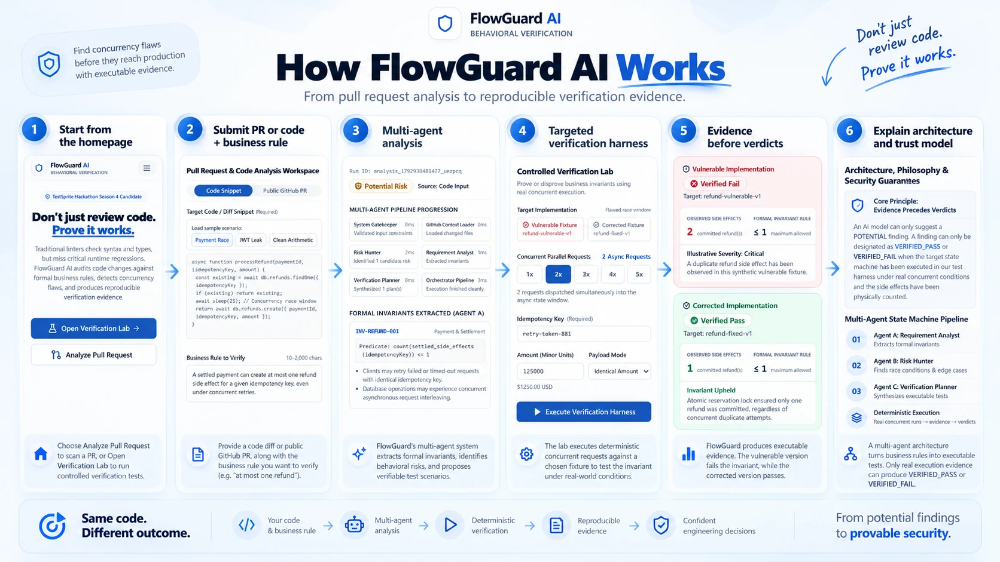

*Illustrative overview generated from project screenshots. For exact execution boundaries, see the diagram and explanations below; a PR analysis does **not** automatically execute the submitted repository in the lab.*

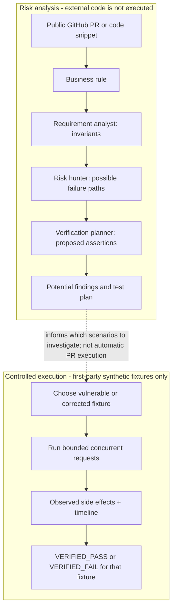

The three analysis roles are **Requirement Analyst**, **Risk Hunter**, and **Verification Planner**. The interface exposes provenance: when a configured external model is not available, analysis falls back to a **deterministic heuristic**, not secretly to a neural model.

## See a real before / after — no fake green results

**Same business rule. Same two concurrent attempts. Two different synthetic implementations.**

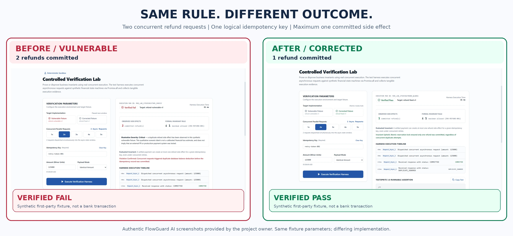

| First-party lab observation | Vulnerable fixture | Corrected fixture |
| :--- | :---: | :---: |
| Concurrent requests | 2 | 2 |
| Committed refund side effects | **2** | **1** |
| Business rule | At most 1 | At most 1 |
| Observed lab verdict | **VERIFIED_FAIL** | **VERIFIED_PASS** |

The left screenshot demonstrates a deliberately vulnerable **simulation fixture**, not a production financial incident. The right demonstrates its corrected fixture under the same configured request count, amount, and idempotency key. **Neither screenshot is evidence of running or fixing an external bank's backend.**

<details><summary><strong>Open the original screenshots (full lab states)</strong></summary>

**Vulnerable** — two committed refund side effects:

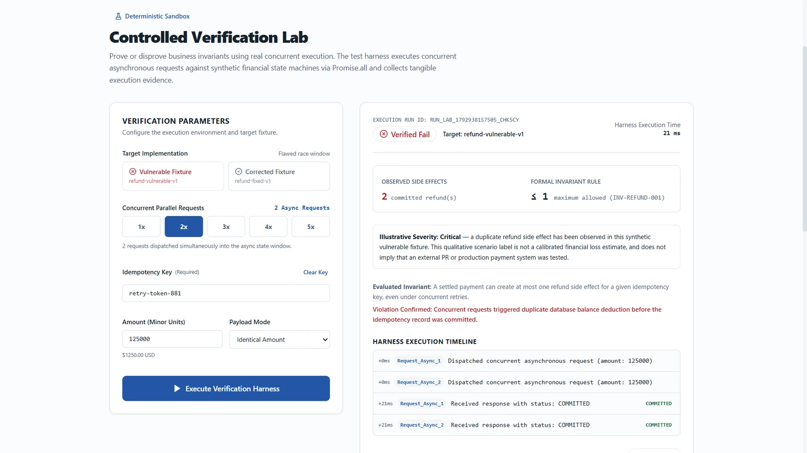

**Corrected** — only one committed refund:

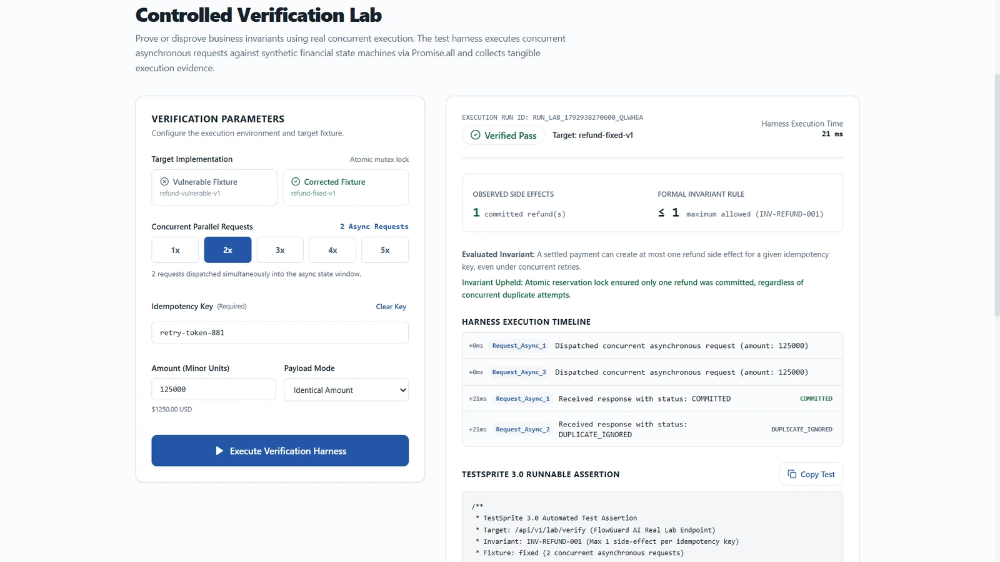

</details>

## Try FlowGuard AI in three minutes

### Route A — demonstrate a behavioral invariant

1. Open the [Verification Lab](https://flowguard-ai-smoky.vercel.app/lab).
2. Select **Vulnerable Fixture**, choose **2x** concurrent requests, retain the same test payment and idempotency key, then click **Execute Verification Harness**.
3. Inspect the committed-refund count, rule `≤ 1`, the verdict, and the event timeline.
4. Switch to **Corrected Fixture** without changing the scenario; run again and compare the side effects.

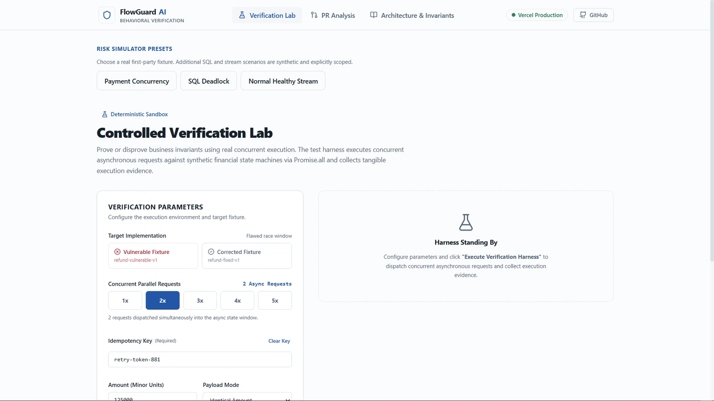

### Route B — inspect a pull request or code snippet

1. Open [PR & Code Analysis](https://flowguard-ai-smoky.vercel.app/analyze).
2. Choose a **Code Snippet** preset (for example, Payment Race) **or** provide an accessible **Public GitHub PR** URL.
3. Supply a business rule, such as *one refund side effect per idempotency key*.
4. Launch analysis; inspect the invariant, provenance, candidate risk, and proposed assertions. **`POTENTIAL` is not a runtime-proven exploit.**

| Input workspace | Result and analysis provenance |
| :---: | :---: |
| 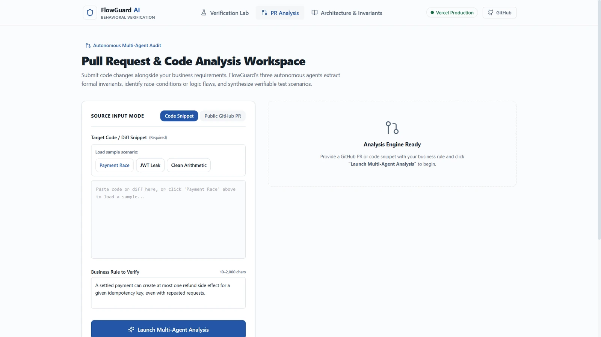 | 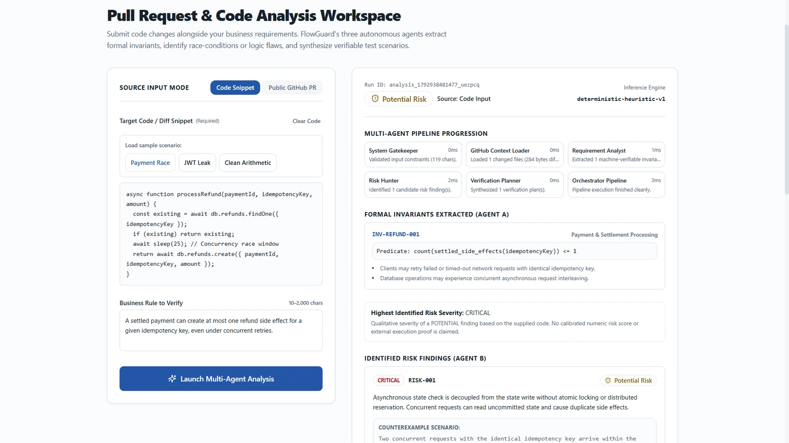 |

## The innovation: evidence precedes verdicts

Our design intentionally separates three kinds of statements:

| Label | What it actually means | Valid scope |
| :--- | :--- | :--- |
| **POTENTIAL** | A risk worth investigating was inferred from code and a business requirement. | Analysis output / hypotheses |
| **VERIFIED_FAIL** | Executed scenario violated its stated invariant. | Specific executed first-party fixture + inputs |
| **VERIFIED_PASS** | Executed scenario upheld its stated invariant. | Specific executed first-party fixture + inputs |

This protects the reader against a common category error: treating AI-generated confidence or an unexecuted test plan as evidence that a third-party system was tested. FlowGuard does not claim its scoped synthetic proof is a universal guarantee for a real deployment.

**What makes the workflow useful for developers and engineering leads:** explicit business rules, read-only PR investigation, reproducible synthetic exercises, provenance-aware results, and independently verifiable project CI. This is a conceptual value proposition—not a quantified productivity or defect-prevention benchmark.

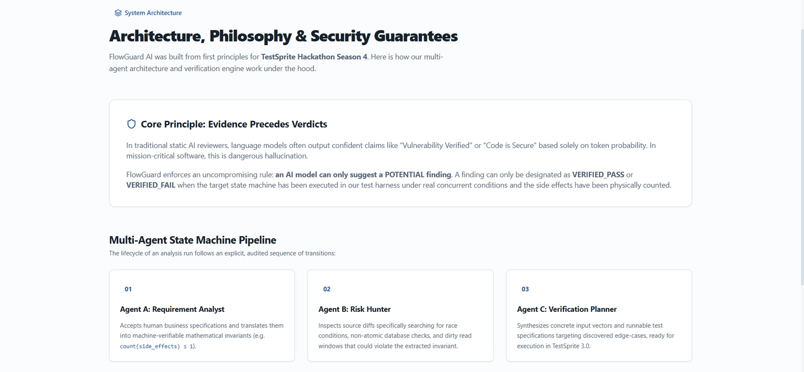

## TestSprite Season 4 — an actual fix-and-retest journey

The project has a genuine TestSprite GitHub App integration. Earlier PR #14 iterations encountered blocked browser cases related to keyboard navigation and copying an assertion. The team improved focus behavior, added targeted `/analyze` cache-control handling, and subsequently implemented first-invalid-field focus and stronger keyboard feedback. **The later keyboard changes have independent CI and hosted-browser verification, but the vendor result below was obtained before the later patch.**

**Historical official TestSprite result on PR #14, earlier commit `7324ee590ca7cfaf3a30173fcb8cdc0afe44b1a8` (NOT the newer code head):**

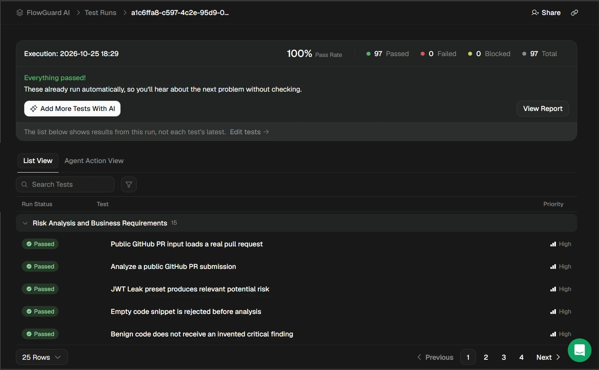

| Checkable evidence | Outcome | Link |
| :--- | :--- | :--- |
| **TestSprite V3 official execution** | **97 passed · 0 failed · 0 blocked** | [Historical vendor report, head `7324ee5`](https://www.testsprite.com/dashboard-v3/o/28a6d5ec-2a40-54eb-9bf6-0c87db224fde/projects/570eab99-607a-49fa-96b2-fe5ef724f2d9/execution/a1c6ffa8-c597-4c2e-95d9-027504a84dbc) |
| **TestSprite V3 GitHub status** | **Success on earlier commit `7324ee5` only** | [GitHub commit status](https://github.com/allfridhosaragii/FlowGuard-AI/commit/7324ee590ca7cfaf3a30173fcb8cdc0afe44b1a8) |
| **Later code commit `170b8875` CI** | **118/118 Vitest and 70/70 Chromium Playwright passed** | [CI 40209717826](https://github.com/allfridhosaragii/FlowGuard-AI/actions/runs/40209717826) |
| **Later code hosted keyboard regressions** | **2/2 on the exact PR preview** | [UX002 hosted audit 40209717811](https://github.com/allfridhosaragii/FlowGuard-AI/actions/runs/40209717811) |
| **Security and toolbox workflows** | **Succeeded under configured policies (not zero-risk certification)** | [Security 40209717856](https://github.com/allfridhosaragii/FlowGuard-AI/actions/runs/40209717856) · [Toolbox 40209717738](https://github.com/allfridhosaragii/FlowGuard-AI/actions/runs/40209717738) |

<details><summary><strong>See the GitHub checks and CI screenshots</strong></summary>

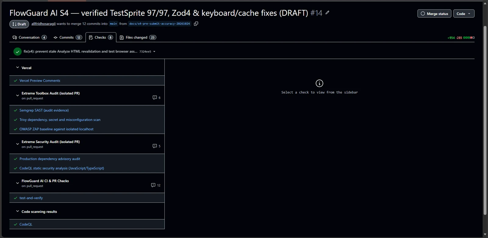

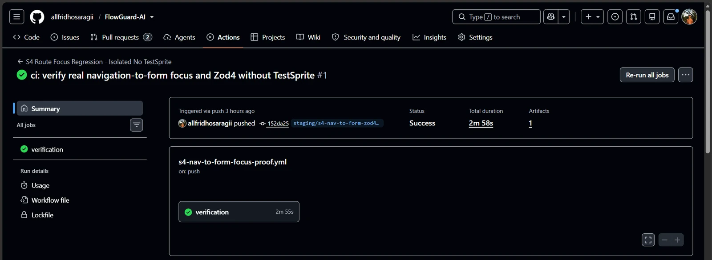

</details>

### The exact PR chronology matters

- **[PR #1](https://github.com/allfridhosaragii/FlowGuard-AI/pull/1)** opened **20 October 2026** during the initial Oct 16–22 build window and received an authentic TestSprite GitHub App comment/status. Its earlier TestSprite suite was **22 passed / 1 blocked**; it is **not** represented as 97/97.
- **[PR #14](https://github.com/allfridhosaragii/FlowGuard-AI/pull/14)** opened **24 October 2026** and achieved the historical **97/97 vendor pass on `7324ee5`**; later commit `170b8875` passed the independent CI and hosted UX002 tests cited above. A new post-documentation commit requires its own checks.
- The public production and the PR preview were different versions at the October 25 checkpoint. Use [PR #14](https://github.com/allfridhosaragii/FlowGuard-AI/pull/14) and the exact commit links to determine the current deployment and tested versions; do not extrapolate earlier results to later commits.

### Security and automated test honesty

A green security workflow means that the workflow completed with its configured policy; it is **not a guarantee of zero security findings**. Relevant caveats include CSP policy trade-offs, action-pinning recommendations, and repository license status. The scoped PR #14 update pins Zod 4.6.7 after a security audit, without implying that an unmerged dependency update is already running in production.

## Technical architecture

| Component | Scope |
| :--- | :--- |
| Web app | Next.js 15 App Router, React 19, TypeScript, Tailwind CSS |
| Analysis | Three-stage agent pipeline with deterministic fallback and optional configured external model providers |
| Input | Public GitHub PR diff **or** code snippet, plus a human business rule |
| Controlled verification | Bounded first-party synthetic async/concurrency scenario runner and evidence trace |
| Developer testing | Vitest, Playwright, multi-browser focused UX checks, GitHub Actions |
| Validation on PR #14 | Zod 4.6.7; scope tied to the PR, not automatically production |

**Public API (v1):**

| Endpoint | Role |
| :--- | :--- |
| `GET /api/v1/health` | Server/build and configured-subsystem status |
| `POST /api/v1/analyses` | PR/snippet analysis with business rule |
| `POST /api/v1/lab/verify` | Executes controlled verification of allowlisted first-party fixtures |

For additional detail, see the [Architecture & Security page](https://flowguard-ai-smoky.vercel.app/about) and repository `docs/` directory.

### Scope, privacy and limitations

- **No arbitrary third-party execution:** FlowGuard never runs the code from submitted external GitHub PRs in the verification lab. The lab executes allowlisted synthetic fixtures only.
- **Risk finding vs proof:** generated risk classifications and runnable-assertion text are not equivalent to executed third-party tests.
- **AI provenance:** with no configured model credentials, results use a clearly identified deterministic heuristic fallback; they should never be labeled real Gemini/OpenAI inference.
- **Read-only source inspection:** public GitHub PRs are inspected through read-only GitHub access with bounded diff size. Avoid sharing secrets or sensitive code in the public demo.
- **Lab limitations:** fixture conclusions cannot cover the concurrency behavior of a live bank, every schedule, all external dependencies, or all business logic.
- **Security posture:** the fact that scans/checks pass does not prove there are no residual vulnerabilities; findings require review and prioritization.
- **License:** the repository does not currently present a confirmed root `LICENSE` file. No license or redistribution permission is claimed here. Licensing remains the maintainer's decision.

## Reproduce locally

Prerequisites: a current supported Node.js environment, npm, and Playwright browser binaries for E2E tests.

```bash
git clone https://github.com/allfridhosaragii/FlowGuard-AI.git
cd FlowGuard-AI
npm ci
npm run dev
# Open http://localhost:3000
```

```bash
npm test           # Vitest
npx playwright install chromium firefox webkit
npm run test:e2e   # Playwright; run against your local instance as configured
npm run lint
npm run build
```

Model-provider integration is **optional**; do not commit secrets or `.env` files. The exact test totals are **commit- and environment-specific**, so use linked workflow executions when comparing results.

## Beyond the hackathon

These are **planned improvements, not shipped capabilities**:

- Expand the fixture library and document additional domain invariants.
- Improve traceability from generated plans to real executed assertions against deliberately authorized test environments.
- Add repeatable benchmark cases for detection usefulness and false-positive analysis.
- Gather structured feedback from developers, QA reviewers, and teams instead of assuming public complaints establish product-market fit.
- Continue hardening dependency and deployment security in reviewed changes.

## Research references and project provenance

**Problem context:** [Indonesian QRIS payment report](https://www.reddit.com/r/indotech/comments/1osvnyi/jebakan_betmen_apa_ada_yang_pernah_gagal/) · [Uber Eats customer report](https://www.reddit.com/r/UberEATS/comments/1sn6soa/uber_this_is_ridiculous/) · [Medusa refund retry issue](https://github.com/medusajs/medusa/issues/16681) · [Stripe idempotency API](https://docs.stripe.com/api/idempotent_requests) · [Google SRE release engineering](https://sre.google/workbook/canarying-releases/)

**Product and verification:** [Live application](https://flowguard-ai-smoky.vercel.app/) · [Public repository](https://github.com/allfridhosaragii/FlowGuard-AI) · [Qualifying PR #1](https://github.com/allfridhosaragii/FlowGuard-AI/pull/1) · [Latest verified PR #14](https://github.com/allfridhosaragii/FlowGuard-AI/pull/14) · [Official TestSprite 97/97](https://www.testsprite.com/dashboard-v3/o/28a6d5ec-2a40-54eb-9bf6-0c87db224fde/projects/570eab99-607a-49fa-96b2-fe5ef724f2d9/execution/a1c6ffa8-c597-4c2e-95d9-027504a84dbc)

**Media provenance:** all product and TestSprite screenshots shown as screenshots originate from the project owner's supplied capture ZIP. The Before/After composite joins two **authentic screenshots** without changing values or verdicts. The illustrated application-flow image is an **AI-generated conceptual visual**, not a screenshot or an execution log. The repository should preserve original source images for auditability.

---

*Evidence checked 26 October 2026 (Asia/Jakarta). Each test outcome is attributed to its cited code version. After any subsequent integration/merge, review the fresh PR checks and production deployment; do not treat historical vendor results as a new run.*