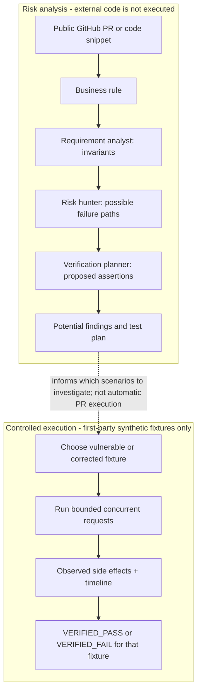

# 🛡️ FlowGuard AI

**Don't just review code. Investigate what could go wrong — and know what the evidence actually proves.**

> **FlowGuard AI** is a browser-based behavioral-risk analysis and verification playground. It compares public PRs or code snippets with explicit business rules, produces evidence-scoped **POTENTIAL** findings and proposed checks, and demonstrates real concurrency behavior in **controlled first-party synthetic fixtures**.

[**🚀 Live app (no login)**](https://flowguard-ai-smoky.vercel.app/) · [**🧪 Try the Verification Lab**](https://flowguard-ai-smoky.vercel.app/lab) · [**🔍 Analyze a PR or snippet**](https://flowguard-ai-smoky.vercel.app/analyze) · [**✅ Final TestSprite 97/97**](https://www.testsprite.com/dashboard-v3/o/28a6d5ec-2a40-54eb-9bf6-0c87db224fde/projects/570eab99-607a-49fa-96b2-fe5ef724f2d9/execution/901e7027-1c4a-477f-adc9-ca0d17b16635) · [**🔀 Verified PR #14**](https://github.com/allfridhosaragii/FlowGuard-AI/pull/14) · [**🎬 Watch the demo video**](https://www.youtube.com/watch?v=rt64hHG1B80)

**🎬 FlowGuard AI demo video:** [Watch the video walkthrough on YouTube](https://www.youtube.com/watch?v=rt64hHG1B80). For hands-on verification, the [live application](https://flowguard-ai-smoky.vercel.app/) and [Verification Lab](https://flowguard-ai-smoky.vercel.app/lab) are available separately.

### Verified quality — final tested versions

| Verification layer | Result | Evidence | Scope / version |
| :--- | :--- | :--- | :--- |
| **Official TestSprite V3 GitHub check** | **97/97 passed · 0 failed · 0 blocked** | [Final vendor execution](https://www.testsprite.com/dashboard-v3/o/28a6d5ec-2a40-54eb-9bf6-0c87db224fde/projects/570eab99-607a-49fa-96b2-fe5ef724f2d9/execution/901e7027-1c4a-477f-adc9-ca0d17b16635) · [PR #14](https://github.com/allfridhosaragii/FlowGuard-AI/pull/14) | Final PR head `0f575c33d3d424843885eac73b46f2ff4b832d0e`; authentic `TestSprite V3: success` **before merge** |
| **Vitest — post-merge** | **118/118 passed** | [GitHub Actions run 40273469302](https://github.com/allfridhosaragii/FlowGuard-AI/actions/runs/40273469302) | `main` squash commit `dd00c0b0a64712da5137c454927ef9c50cebd8be` |
| **Playwright Chromium — post-merge** | **70/70 passed** | [Same CI run](https://github.com/allfridhosaragii/FlowGuard-AI/actions/runs/40273469302) | `main` squash commit `dd00c0b0a64712da5137c454927ef9c50cebd8be` |
| **Hosted keyboard regression** | **2/2 passed** | [Final PR-preview browser audit](https://github.com/allfridhosaragii/FlowGuard-AI/actions/runs/40273003554) | Final PR head `0f575c3`; a separate hosted test, not TestSprite cases |
| **Qualifying build-window PR** | Genuine GitHub App activity | [PR #1](https://github.com/allfridhosaragii/FlowGuard-AI/pull/1) | Opened October 20, 2026; its original `22 passed / 1 blocked` is **historical** |

**Version integrity:** the final vendor run was attached to **PR #14 head `0f575c3`**, not rerun on `main` squash SHA `dd00c0b`. The two commits have been checked to contain the **same Git tree**, but their executions and commit identities must not be conflated. Passing 97 cases is **not a claim of 100% code coverage**.


<details><summary><strong>See the mobile homepage screenshot</strong></summary>


</details>

### Judge's 60-second hands-on path

1. Open the [Verification Lab](https://flowguard-ai-smoky.vercel.app/lab), run the **Vulnerable** refund fixture with 2 concurrent attempts, and inspect **2 committed side effects → VERIFIED_FAIL**.
2. Run the **Corrected** fixture with the same logical idempotency key and compare **1 committed side effect → VERIFIED_PASS**.
3. Open [PR & Code Analysis](https://flowguard-ai-smoky.vercel.app/analyze), try the **Payment Race** snippet, and observe why inferred risks are labeled **POTENTIAL** rather than incorrectly marked as verified.
4. Confirm the [final TestSprite check](https://github.com/allfridhosaragii/FlowGuard-AI/pull/14) and [97/97 execution](https://www.testsprite.com/dashboard-v3/o/28a6d5ec-2a40-54eb-9bf6-0c87db224fde/projects/570eab99-607a-49fa-96b2-fe5ef724f2d9/execution/901e7027-1c4a-477f-adc9-ca0d17b16635).

## Why we care: behind a software failure is a real person

The starting point for our **problem statement** is simple: software errors affect real people, not just dashboards. Public reports illustrate confusing payment states and temporary loss of access to funds; a developer issue documents a *possible* refund-retry identity error. They motivate a broader engineering question: **how can developers detect risky changes and verify the intended business rule?**

The sources below are **independent public reports**, gathered as evidence of the problem's real-world relevance. They are **not** proof of a shared root cause, confirmed defects in those third-party services, endorsements, or evidence that FlowGuard AI actually handled those transactions. We do not represent them as documented historical inspiration for the original idea.

| Publicly reported experience | What it illustrates | Primary source |
| :--- | :--- | :--- |
| An Indonesian user said a QRIS-funded in-app purchase was marked **cancelled** although their mobile-banking balance had been debited. | A payment's customer-facing state can differ across systems; resolving the discrepancy matters to real people. | [r/indotech, November 2025](https://www.reddit.com/r/indotech/comments/1osvnyi/jebakan_betmen_apa_ada_yang_pernah_gagal/) |
| An Uber Eats customer described apparently duplicated transactions and temporarily unavailable funds; participants discussed whether one entry was an **authorization hold** rather than a second settled charge. | Even an unresolved or held transaction can undermine trust and liquidity. | [r/UberEATS, April 2026](https://www.reddit.com/r/UberEATS/comments/1sn6soa/uber_this_is_ridiculous/) |
| A Medusa contributor reported a refund-retry path that could use different idempotency keys after provider errors. | Retry behavior and business state transitions deserve explicit review. The risk of double refund is **conditional**, not proof that customers were refunded twice. | [medusajs/medusa issue #16681](https://github.com/medusajs/medusa/issues/16681) |

**What these links do *not* prove:** that the reported consumer incidents share one root cause; that any commenter requested or endorses FlowGuard AI; or that this app prevented their losses. They are **problem-context evidence**, not product-market-fit research or testimonials.

For the engineering rationale, see [Stripe's idempotent-request API documentation](https://docs.stripe.com/api/idempotent_requests) and [Google's SRE workbook on canary releases](https://sre.google/workbook/canarying-releases/). They explain why retried operations need careful identity/semantics and why repeatable automated checks matter during software changes.

## The practical gap: valid code can still break a business rule

A type checker can approve two syntactically valid requests, while a non-atomic payment handler still allows a duplicate side effect. Existing linters, code review, integration tests, and dedicated test platforms all matter; **FlowGuard AI complements them** by asking a different question:

> *Does this proposed code change threaten a business invariant — and what evidence would be required to confirm or reject the concern?*

For example:

```text
Business invariant INV-REFUND-001:
For any given logical idempotency key,
committed_refund_side_effect_count(key) <= 1
```

FlowGuard can identify a **POTENTIAL** race from a snippet or public PR and suggest an assertion. It **cannot** mark arbitrary GitHub PR code as `VERIFIED_FAIL` merely by reading it. Only running a specific controlled test against a specific executable target can produce an evidence-backed verdict.

## How the two workflows fit together


*Illustrative overview generated from project screenshots. For exact execution boundaries, see the diagram and explanations below; a PR analysis does **not** automatically execute the submitted repository in the lab.*



The three analysis roles are **Requirement Analyst**, **Risk Hunter**, and **Verification Planner**. The interface exposes provenance: when a configured external model is not available, analysis falls back to a **deterministic heuristic**, not secretly to a neural model.

## See a real before / after — no fake green results

**Same business rule. Same two concurrent attempts. Two different synthetic implementations.**


| First-party lab observation | Vulnerable fixture | Corrected fixture |
| :--- | :---: | :---: |
| Concurrent requests | 2 | 2 |
| Committed refund side effects | **2** | **1** |
| Business rule | At most 1 | At most 1 |
| Observed lab verdict | **VERIFIED_FAIL** | **VERIFIED_PASS** |

The left screenshot demonstrates a deliberately vulnerable **simulation fixture**, not a production financial incident. The right demonstrates its corrected fixture under the same configured request count, amount, and idempotency key. **Neither screenshot is evidence of running or fixing an external bank's backend.**

<details><summary><strong>Open the original screenshots (full lab states)</strong></summary>

**Vulnerable** — two committed refund side effects:


**Corrected** — only one committed refund:


</details>

## Try FlowGuard AI in three minutes

### Route A — demonstrate a behavioral invariant

1. Open the [Verification Lab](https://flowguard-ai-smoky.vercel.app/lab).
2. Select **Vulnerable Fixture**, choose **2x** concurrent requests, retain the same test payment and idempotency key, then click **Execute Verification Harness**.
3. Inspect the committed-refund count, rule `≤ 1`, the verdict, and the event timeline.
4. Switch to **Corrected Fixture** without changing the scenario; run again and compare the side effects.


### Route B — inspect a pull request or code snippet

1. Open [PR & Code Analysis](https://flowguard-ai-smoky.vercel.app/analyze).
2. Choose a **Code Snippet** preset (for example, Payment Race) **or** provide an accessible **Public GitHub PR** URL.
3. Supply a business rule, such as *one refund side effect per idempotency key*.
4. Launch analysis; inspect the invariant, provenance, candidate risk, and proposed assertions. **`POTENTIAL` is not a runtime-proven exploit.**

| Input workspace | Result and analysis provenance |
| :---: | :---: |
|  |  |

## The innovation: evidence precedes verdicts

Our design intentionally separates three kinds of statements:

| Label | What it actually means | Valid scope |
| :--- | :--- | :--- |
| **POTENTIAL** | A risk worth investigating was inferred from code and a business requirement. | Analysis output / hypotheses |
| **VERIFIED_FAIL** | Executed scenario violated its stated invariant. | Specific executed first-party fixture + inputs |
| **VERIFIED_PASS** | Executed scenario upheld its stated invariant. | Specific executed first-party fixture + inputs |

This protects the reader against a common category error: treating AI-generated confidence or an unexecuted test plan as evidence that a third-party system was tested. FlowGuard does not claim its scoped synthetic proof is a universal guarantee for a real deployment.

**What makes the workflow useful for developers and engineering leads:** explicit business rules, read-only PR investigation, reproducible synthetic exercises, provenance-aware results, and independently verifiable project CI. This is a conceptual value proposition—not a quantified productivity or defect-prevention benchmark.


## TestSprite Season 4 — from investigation to a green required PR check

This is a **genuine automated GitHub pull-request workflow**, not a screenshot-only test claim. TestSprite's GitHub App ran against PR-linked Vercel previews; `main` required both **`TestSprite V3`** and **`test-and-verify`** checks. The final PR was merged only after the required check was green.

### A real development and testing journey

1. **Build-window proof:** [PR #1](https://github.com/allfridhosaragii/FlowGuard-AI/pull/1) opened **October 20, 2026**, with authentic TestSprite App feedback. Its original `22 passed / 1 blocked` belongs only to that early iteration.
2. **Blocked investigation:** an intermediate [PR #14](https://github.com/allfridhosaragii/FlowGuard-AI/pull/14) vendor run returned **96 Passed / 0 Failed / 1 Blocked**. The blocked browser case involved keyboard navigation and user feedback. We reviewed focus behavior, strengthened validation feedback, and verified usability through CI and hosted browser checks.
3. **Organizer / engineering clarification (October 27):** TestSprite engineering told the participant that repeated **Tab** actions in the test plan triggered the agent's safeguard against repeating unchanged actions. They recommended clicking the target field first, then checking successive Tab focus transitions. They also clarified that **Send test event** can report `success` independent of actual test results and must **not** be treated as a real run. This means an earlier confusing green status was not proof of passing failed tests; subsequent genuine trigger results behaved correctly.
4. **Final genuine vendor outcome:** official [TestSprite V3 run on PR #14 head `0f575c3`](https://www.testsprite.com/dashboard-v3/o/28a6d5ec-2a40-54eb-9bf6-0c87db224fde/projects/570eab99-607a-49fa-96b2-fe5ef724f2d9/execution/901e7027-1c4a-477f-adc9-ca0d17b16635) recorded **97 Passed / 0 Failed / 0 Blocked**, with a matching required GitHub **success** check. [PR #14](https://github.com/allfridhosaragii/FlowGuard-AI/pull/14) was merged **October 26, 2026**.
5. **Independent after-merge checks:** `main` commit `dd00c0b` passed **118/118 Vitest** and **70/70 Playwright Chromium** in [CI 40273469302](https://github.com/allfridhosaragii/FlowGuard-AI/actions/runs/40273469302). This is separate from the vendor's 97 cases.

**Evidence interpretation:** the earlier blocked browser case was **not established to be a product defect or a TestSprite runner bug**. Accessibility improvements were made and independently checked, while the organizer's test-plan safeguard diagnosis must be preserved. The authentic final green run is cited above; earlier failures remain in the traceable PR history.

| Evidence to inspect | Outcome / interpretation | Link |
| :--- | :--- | :--- |
| **Final official TestSprite V3 execution** | **97/97 passed; 0 failed; 0 blocked** on `0f575c3` | [Vendor report](https://www.testsprite.com/dashboard-v3/o/28a6d5ec-2a40-54eb-9bf6-0c87db224fde/projects/570eab99-607a-49fa-96b2-fe5ef724f2d9/execution/901e7027-1c4a-477f-adc9-ca0d17b16635) |
| **Final GitHub PR status** | `TestSprite V3: success`; merge complete | [PR #14](https://github.com/allfridhosaragii/FlowGuard-AI/pull/14) |
| **Post-merge CI** | 118 Vitest + 70 Chromium Playwright passed on `dd00c0b` | [CI run](https://github.com/allfridhosaragii/FlowGuard-AI/actions/runs/40273469302) |
| **Final hosted keyboard regressions** | 2/2 passed, separate hosted check | [Hosted audit](https://github.com/allfridhosaragii/FlowGuard-AI/actions/runs/40273003554) |
| **Security / dependency audit** | Workflows succeeded under their configured policies; **not proof of zero findings** | [Security run](https://github.com/allfridhosaragii/FlowGuard-AI/actions/runs/40273003506) |
| **Semgrep / Trivy / ZAP toolbox** | Workflow succeeded; some scanner warnings require follow-up | [Toolbox run](https://github.com/allfridhosaragii/FlowGuard-AI/actions/runs/40273003565) |


*Image provenance: this is an authentic owner-supplied TestSprite screenshot, but its saved capture alone does not establish the final head's execution. The final result must be verified through the linked vendor run and GitHub PR.*

<details><summary><strong>See original GitHub checks and CI screenshots</strong></summary>


</details>

### Security and testing limitations

- **Production-scoped npm audit:** the audited final PR workflow reported no production high/critical npm advisories at its checked snapshot. This is **not** a blanket security certification.
- **Developer dependencies:** an all-dependency audit reported **2 critical and 4 moderate** advisories in dev-tooling dependencies at its checked snapshot; no claims are made that those were fixed.
- **Toolbox scanners:** Semgrep identified mutable GitHub Actions tags; ZAP raised CSP `unsafe-inline` warnings. Green workflow completion does not erase those findings.
- **No 100% coverage claim:** vendor cases, unit tests, and browser tests cover distinct scopes and versions.
- **Root license:** no confirmed root `LICENSE` was present at the audited checkpoint; no open-source license grant is implied.

## Technical architecture

| Component | Scope |
| :--- | :--- |
| Web app | Next.js 15 App Router, React 19, TypeScript, Tailwind CSS |
| Analysis | Three-stage agent pipeline with deterministic fallback and optional configured external model providers |
| Input | Public GitHub PR diff **or** code snippet, plus a human business rule |
| Controlled verification | Bounded first-party synthetic async/concurrency scenario runner and evidence trace |
| Developer testing | Vitest, Playwright, multi-browser focused UX checks, GitHub Actions |
| Dependency validation on final tested code | Zod 4.6.7; final PR tree matches merged `main` tree |

**Public API (v1):**

| Endpoint | Role |
| :--- | :--- |
| `GET /api/v1/health` | Server/build and configured-subsystem status |
| `POST /api/v1/analyses` | PR/snippet analysis with business rule |
| `POST /api/v1/lab/verify` | Executes controlled verification of allowlisted first-party fixtures |

For additional detail, see the [Architecture & Security page](https://flowguard-ai-smoky.vercel.app/about) and repository `docs/` directory.

### Scope, privacy and limitations

- **No arbitrary third-party execution:** In the documented version, FlowGuard does not run code from submitted external GitHub PRs in the verification lab. The lab executes allowlisted synthetic fixtures only.
- **Risk finding vs proof:** generated risk classifications and runnable-assertion text are not equivalent to executed third-party tests.
- **AI provenance:** with no configured model credentials, results use a clearly identified deterministic heuristic fallback; they should never be labeled real Gemini/OpenAI inference.
- **Read-only source inspection:** public GitHub PRs are inspected through read-only GitHub access with bounded diff size. Avoid sharing secrets or sensitive code in the public demo.
- **Lab limitations:** fixture conclusions cannot cover the concurrency behavior of a live bank, every schedule, all external dependencies, or all business logic.
- **Security posture:** the fact that scans/checks pass does not prove there are no residual vulnerabilities; findings require review and prioritization.
- **License:** the repository does not currently present a confirmed root `LICENSE` file. No license or redistribution permission is claimed here. Licensing remains the maintainer's decision.

## Reproduce locally

Prerequisites: a current supported Node.js environment, npm, and Playwright browser binaries for E2E tests.

```bash
git clone https://github.com/allfridhosaragii/FlowGuard-AI.git
cd FlowGuard-AI
npm ci
npm run dev
# Open http://localhost:3000
```

```bash
npm test           # Vitest
npx playwright install chromium firefox webkit
npm run test:e2e   # Playwright; run against your local instance as configured
npm run lint
npm run build
```

Model-provider integration is **optional**; do not commit secrets or `.env` files. The exact test totals are **commit- and environment-specific**, so use linked workflow executions when comparing results.

## Community posts & TestSprite feedback

These are **published, owner-authored project updates and feedback**, not independently established external product reviews. They document the build, the actual TestSprite experience, and lessons for developers.

| Platform | Content | Public link |
| :--- | :--- | :--- |
| **X — milestone** | FlowGuard AI, final TestSprite 97/97, post-merge Vitest and Playwright | [Testing milestone](https://x.com/alperindoo/status/2114801746224828666) |
| **X — TestSprite feedback** | Automated PR checks and learning from keyboard usability investigation | [TestSprite feedback](https://x.com/alperindoo/status/2114804234940191061) |
| **Threads** | Why automated testing and a required check improved the workflow | [Development reflection](https://www.threads.com/share/BAVzq1jPcG/) |
| **Medium** | Detailed first-person build story and constructive TestSprite feedback | [From blocked tests to 97/97](https://medium.com/@pedoprimasaragi/how-testsprite-helped-me-build-a-better-flowguard-ai-from-blocked-tests-to-97-97-passed-77aec2fb0828) |
| **DEV Community** | Concurrency/idempotency, synthetic reproduction and PR verification | [Technical write-up](https://dev.to/allfridho_saragi_34662165/what-testsprite-taught-me-about-testing-concurrency-bugs-in-flowguard-ai-5gj3) |

**Direct feedback to TestSprite:** the GitHub integration and clearly separated Passed / Failed / Blocked states were useful for iterating on FlowGuard AI. An area for improvement would be richer diagnostics and actionable test-plan guidance when browser-agent safeguards are triggered. TestSprite engineering subsequently provided a concrete explanation and suggested test-plan steps; those details help distinguish tool behavior from confirmed app defects.

### Video walkthrough — FlowGuard AI demo

**[▶ Watch the FlowGuard AI demo on YouTube](https://www.youtube.com/watch?v=rt64hHG1B80)**

The walkthrough provides a video companion to the runnable [live application](https://flowguard-ai-smoky.vercel.app/), [controlled Verification Lab](https://flowguard-ai-smoky.vercel.app/lab), and independently verifiable [final TestSprite execution](https://www.testsprite.com/dashboard-v3/o/28a6d5ec-2a40-54eb-9bf6-0c87db224fde/projects/570eab99-607a-49fa-96b2-fe5ef724f2d9/execution/901e7027-1c4a-477f-adc9-ca0d17b16635). The official product and test evidence comes from those linked original sources; video editing alone is not verification.

[](https://www.youtube.com/watch?v=rt64hHG1B80)

*The image above is an authentic FlowGuard AI homepage screenshot and links to the owner-provided video; it is not a captured frame from the YouTube video.*

## Beyond the hackathon

These are **planned improvements, not shipped capabilities**:

- Expand the fixture library and document additional domain invariants.
- Improve traceability from generated plans to real executed assertions against deliberately authorized test environments.
- Add repeatable benchmark cases for detection usefulness and false-positive analysis.
- Gather structured feedback from developers, QA reviewers, and teams instead of assuming public complaints establish product-market fit.
- Continue hardening dependency and deployment security in reviewed changes.

## Research references and project provenance

**Problem context:** [Indonesian QRIS payment report](https://www.reddit.com/r/indotech/comments/1osvnyi/jebakan_betmen_apa_ada_yang_pernah_gagal/) · [Uber Eats customer report](https://www.reddit.com/r/UberEATS/comments/1sn6soa/uber_this_is_ridiculous/) · [Medusa refund retry issue](https://github.com/medusajs/medusa/issues/16681) · [Stripe idempotency API](https://docs.stripe.com/api/idempotent_requests) · [Google SRE release engineering](https://sre.google/workbook/canarying-releases/)

**Product and verification:** [Live application](https://flowguard-ai-smoky.vercel.app/) · [Public repository](https://github.com/allfridhosaragii/FlowGuard-AI) · [Qualifying PR #1](https://github.com/allfridhosaragii/FlowGuard-AI/pull/1) · [Final verified PR #14](https://github.com/allfridhosaragii/FlowGuard-AI/pull/14) · [Final TestSprite 97/97](https://www.testsprite.com/dashboard-v3/o/28a6d5ec-2a40-54eb-9bf6-0c87db224fde/projects/570eab99-607a-49fa-96b2-fe5ef724f2d9/execution/901e7027-1c4a-477f-adc9-ca0d17b16635) · [Post-merge CI](https://github.com/allfridhosaragii/FlowGuard-AI/actions/runs/40273469302)

**Media provenance:** all product and TestSprite screenshots shown as screenshots originate from the project owner's supplied capture ZIP. The Before/After composite joins two **authentic screenshots** without changing values or verdicts. The illustrated application-flow image is an **AI-generated conceptual visual**, not a screenshot or an execution log. The repository should preserve original source images for auditability.

---

*Evidence audit for this preview: 27 October 2026 (Asia/Jakarta). Final TestSprite outcomes remain tied to the exact PR head; post-merge CI is attributed to its own squash commit. Recheck linked sources if the GitHub branch or video publication changes.*